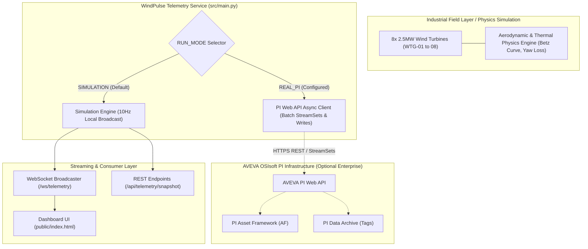

# 🌪️ WindPulse — Renewable Wind Fleet Telemetry & AVEVA OSIsoft PI Web API Architecture

[](https://docs.aveva.com)
[](https://fastapi.tiangolo.com)
[](file:///Users/tejashr/live-projects/WindPulse-Aveva-PI-Telemetry/tests)
[](https://tejashr0716.github.io/windpulse/)

> **Industrial Telemetry & SCADA Gateway Prototype**  
> Real-time wind turbine fleet telemetry engine demonstrating AVEVA OSIsoft PI Data Archive, PI Asset Framework (AF), and PI Web API integration contracts, accompanied by a physics-based simulation engine for local verification without requiring proprietary PI licenses.

---

> [!IMPORTANT]
> **SIMULATED DATA — NOT CONNECTED TO PI BY DEFAULT**  
> Access to an active, licensed AVEVA PI Data Archive and PI Web API instance requires proprietary enterprise infrastructure and credentials. When running locally without active PI credentials (`RUN_MODE=SIMULATION`), WindPulse operates in a physics-based aerodynamic simulation mode with clear visual and API status indicators.

---

## 📌 Implementation Status & Feature Matrix

| Feature | Implementation Mode | Verification / Test Status | Notes |
|---|---|---|---|
| **Physics Aerodynamic Simulation** | Implemented (`src/simulation.py`) | Tested (`tests/test_simulation.py`) | Models Betz limit ($C_p \le 0.593$), cubic power curve, cut-in ($3.0\,\text{m/s}$), cut-out ($25.0\,\text{m/s}$), yaw misalignment losses ($\cos^2\theta$), and thermal dissipation. |
| **PI Web API Async Client** | Implemented (`src/pi_web_api/client.py`) | Tested (`tests/test_pi_client_contracts.py`) | Handles Basic and Bearer auth, WebID 2.0 caching, batch StreamSets, exponential backoff retries, and strict `Good=False` quality flag validation. |
| **Point Value Write Safety Guard** | Implemented (`src/pi_web_api/client.py`) | Tested (`tests/test_pi_write_safety.py`) | Two-layer protection: disabled by default (`PI_ALLOW_WRITES=False`), requires tag whitelist matching, and performs mandatory read-back verification within tolerance. |
| **FastAPI REST & WebSocket Hub** | Implemented (`src/main.py`) | Tested (`tests/test_api_endpoints.py`, `benchmarks/`) | 10Hz WebSocket streaming broadcast, snapshot REST queries, manual wind speed control, and emergency trip endpoints. |
| **Real AVEVA PI Infrastructure** | Configured (`src/config.py`) | Gracefully Skipped (`tests/test_pi_real_integration.py`) | Requires authorized enterprise PI host. Marked skipped when `RUN_MODE != REAL_PI`. No fake live connections are claimed. |

---

## 🏗️ System Architecture



---

## 🛡️ PI Web API Safety & Quality Assurance

### 1. PI Data Quality Flag Validation
In AVEVA PI, time-series streams return digital status indicators (e.g., `Scan Off`, `I/O Timeout`, `Bad Input`) with a boolean `Good: false` flag. The ingestion parser in `src/models.py` (`PIStreamValue.get_numeric_value()`) strictly rejects non-good or string digital state values:
```python
# Returns None for non-good or digital states to prevent corrupting downstream calculations
if not self.Good:
    return None
```

### 2. Guarded Point Write Protection
Writing setpoints or overrides to industrial PI Points can disrupt plant operations. WindPulse implements strict safeguards:
1. **Global Killswitch:** `PI_ALLOW_WRITES` defaults to `False`. Writes raise a `PermissionError` immediately if disabled.
2. **Point Whitelist:** Writes are validated against `PI_APPROVED_WRITE_POINTS`. Unregistered tags are blocked.
3. **Read-Back Verification:** Every successful write triggers an immediate read-back query to ensure the Data Archive accepted the value within a configurable tolerance ($\pm 0.05$).

---

## 🔬 Reproducible Benchmark Results

All benchmarks were run locally against the live FastAPI Uvicorn server (`http://127.0.0.1:8001`). Raw output artifacts are version-controlled in [`benchmarks/results/`](benchmarks/results/).

### 1. Network WebSocket Frame Delivery
- **Script:** `python benchmarks/benchmark_simulation.py`
- **Clients:** 20 concurrent network WebSocket connections (using the `websockets` library over real TCP sockets)
- **Duration:** 5.1 seconds
- **Total Frames Delivered:** 1,020 frames
- **Connection Failures:** 0
- **Throughput:** 200.0 frames/sec (10Hz broadcast across 20 clients)
- **Inter-Frame Latency:**
  - **P50:** 102.87 ms
  - **P95:** 106.18 ms
  - **P99:** 108.02 ms

### 2. HTTP REST Fleet Snapshot Query
- **Requests:** 200 requests (concurrency: 10)
- **Endpoint:** `GET /api/telemetry/snapshot`
- **Successful Responses:** 200 / 200 (100%)
- **Throughput:** 570.5 requests/sec
- **Round-Trip Latency:**
  - **P50:** 13.08 ms
  - **P95:** 30.08 ms
  - **P99:** 79.03 ms

### 3. Real PI Web API Round-Trip Latency
- **Result:** `NOT MEASURED — NO LICENSED PI INFRASTRUCTURE CONFIGURED`
- *Note:* Real PI Web API response times depend on network routing, PI Data Archive indexing, and Kerberos/Basic authentication overhead. WindPulse does not extrapolate or fabricate real PI latencies.

**Raw Evidence Files:**
- JSON: [`benchmarks/results/windpulse_benchmark_1792684007.json`](benchmarks/results/windpulse_benchmark_1792684007.json)
- CSV: [`benchmarks/results/windpulse_benchmark_1792684007.csv`](benchmarks/results/windpulse_benchmark_1792684007.csv)

---

## 🚀 Reproduction & Verification Commands

### 1. Environment Setup
```bash
git clone https://github.com/tejashr0716/WindPulse-Aveva-PI-Telemetry.git
cd WindPulse-Aveva-PI-Telemetry
git checkout grounded-implementation
python3 -m venv .venv
source .venv/bin/activate
pip install -r requirements.txt
```

### 2. Run Test Suite
```bash
pytest -v
```
*Expected Result:* `25 passed, 2 skipped in ~0.06s` (Real PI tests skipped due to absent enterprise credentials).

### 3. Run FastAPI Telemetry Server
```bash
python3 src/main.py
# Server starts at http://127.0.0.1:8001
# API docs available at http://127.0.0.1:8001/docs
```

### 4. Execute Benchmark Suite
In a separate terminal while the server is running:
```bash
python3 benchmarks/benchmark_simulation.py
```

### 5. Access Frontend Prototype
Serve the static dashboard or open `public/index.html` in any browser:
```bash
python3 -m http.server 3000 --directory public
```
Navigate to `http://127.0.0.1:3000`. The UI will connect to `ws://127.0.0.1:8001/ws/telemetry` and display live turbine metrics with the `SIMULATED DATA — NOT CONNECTED TO PI` disclaimer badge.

---

## 📖 Industrial Telemetry Architecture Guide

### Q1: What is the benefit of PI Web API over PI OLEDB or traditional AF SDK?
> **Answer:** PI AF SDK is bound to Windows .NET environments. PI Web API is a platform-independent, RESTful and WebSocket-enabled gateway that allows cloud-native microservices (Python, Go, Node.js) and modern web frontends running on Linux or containerized environments to interact with time-series and AF data securely across enterprise firewalls.

### Q2: How do you optimize PI Web API query performance across thousands of tags?
> **Answer:** Never query single streams (`/streams/{webId}/value`) in sequential loops. Instead:
> 1. Use **PI Web API StreamSets** (`/streamsets/getrecorded` or `/streamsets/getinterpolated`) to pull arrays of related points in a single HTTP call.
> 2. Use the **PI Web API Batch Controller** (`POST /piwebapi/batch`) to consolidate multiple REST requests into a single network round trip.
> 3. Use **PI Web API Channels (WebSockets)** for streaming push notifications rather than polling.
> 4. Cache **WebID 2.0** identifiers locally to bypass path-resolution round trips.
