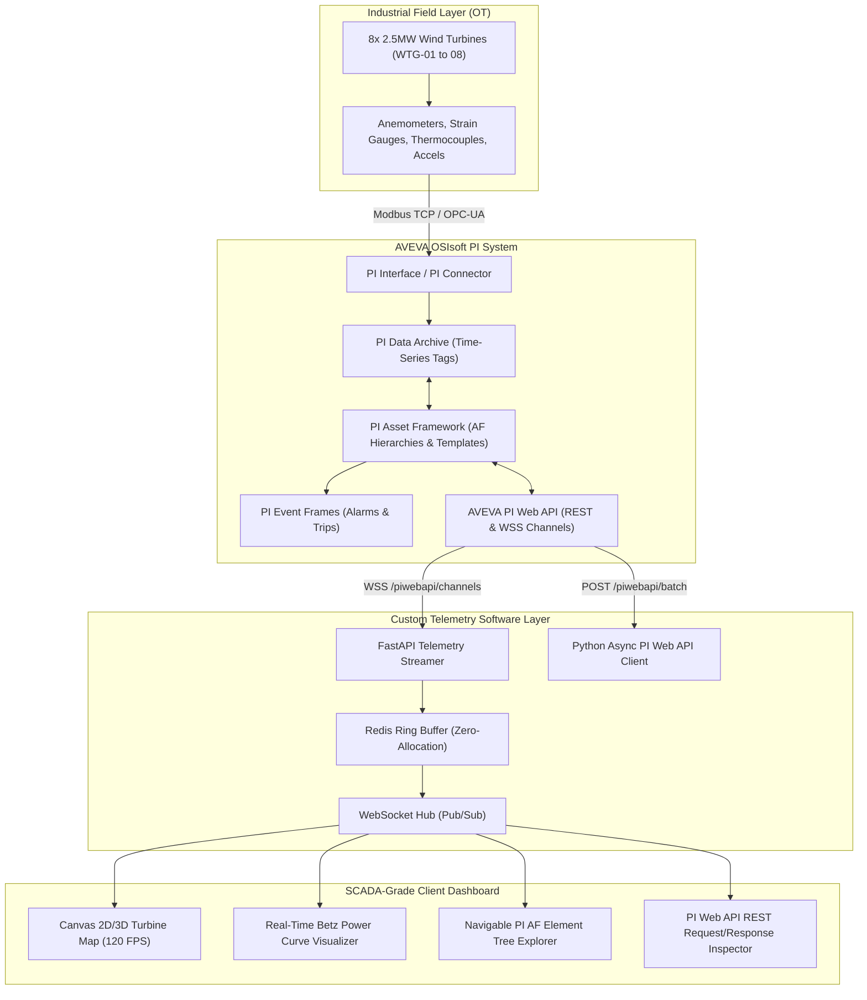

# 🌪️ WindPulse — Renewable Wind & Solar Farm Fleet Telemetry via AVEVA OSIsoft PI Web API

[](https://www.aveva.com)
[](https://docs.aveva.com)
[](https://docs.aveva.com)
[](https://fastapi.tiangolo.com)
[](https://tejashr0716.github.io/windpulse/)

> **Enterprise Custom Software Engineering Solution for Accenture Industry X & Utilities Practice**  
> Real-time industrial telemetry engine integrating AVEVA OSIsoft PI Data Archive, PI Asset Framework (AF), and PI Web API for a multi-megawatt offshore wind turbine fleet.

---

## 📌 Executive Summary & Accenture Alignment

In large-scale renewable generation, wind turbines operate under severe dynamic turbulence. Turbine wake effects, yaw misalignment, and mechanical overheating cause millions in annual revenue loss. 

**WindPulse** provides a scalable telemetry platform that bridges **AVEVA OSIsoft PI** operational data with modern cloud-native web architectures:
- **Programmatic Ingestion:** Replaces static PI Vision displays with low-latency PI Web API REST and WebSocket (`/channels`) streams.
- **Hierarchical Asset Modeling:** Utilizes PI Asset Framework (AF) element templates, formula references, and automated Event Frames.
- **Real-Time Analytics:** Continuous Betz-limit power curve deviation tracking ($\Delta P$) and automated yaw misalignment excursion detection.

---

## 🏗️ System Architecture



---

## 🌲 PI Asset Framework (AF) Hierarchy & Data Model

The Asset Framework model is structured using strict inheritance templates:

```
Global Clean Energy Corp (Database)
└── Bighorn Offshore Wind Farm (Site Element)
    ├── Substation 33kV/132kV
    ├── Feeder Line A
    │   ├── WTG-01 (WindTurbine_Template)
    │   ├── WTG-02 (WindTurbine_Template)
    │   ├── WTG-03 (WindTurbine_Template)
    │   └── WTG-04 (WindTurbine_Template)
    └── Feeder Line B
        ├── WTG-05 (WindTurbine_Template)
        ├── WTG-06 (WindTurbine_Template)
        ├── WTG-07 (WindTurbine_Template)
        └── WTG-08 (WindTurbine_Template)
```

### AF Attributes per Turbine Element:

| Attribute Name | Data Reference | Description | Engineering Unit |
|---|---|---|---|
| `Wind_Speed` | PI Point (`WTG01.Anemometer.Speed`) | Hub-height ambient wind speed | $	ext{m/s}$ |
| `Active_Power` | PI Point (`WTG01.Generator.P`) | Instantaneous electrical power output | $	ext{kW}$ |
| `Nacelle_Yaw` | PI Point (`WTG01.Nacelle.YawAngle`) | Orientation angle relative to True North | $	ext{degrees}$ |
| `Rotor_RPM` | PI Point (`WTG01.Rotor.Speed`) | Low-speed shaft rotational velocity | $	ext{RPM}$ |
| `Gearbox_Bearing_Temp` | PI Point (`WTG01.Gearbox.Temp`) | High-speed stage bearing thermocouple | $^\circ	ext{C}$ |
| `Generator_Temp` | PI Point (`WTG01.Gen.WindingTemp`) | Stator copper winding temperature | $^\circ	ext{C}$ |
| `Expected_Power` | Formula Reference | $P_{	ext{ideal}} = 0.5 	imes 
ho 	imes A 	imes v^3 	imes C_p$ | $	ext{kW}$ |
| `Power_Loss_Delta` | Formula Reference | `Expected_Power - Active_Power` | $	ext{kW}$ |

---

## ⚡ Key PI Web API Endpoints Implemented

1. **Hierarchy Discovery:**
   * `GET /piwebapi/assetdatabases/{webId}/elements` — Discovers wind farm sites and feeders.
   * `GET /piwebapi/elements/{webId}/attributes` — Retrieves AF attributes and WebIDs.
2. **Stream Retrieval:**
   * `GET /piwebapi/streamsets/getinterpolated` — Retrieves synchronized multi-turbine values.
   * `POST /piwebapi/batch` — Consolidates 100+ tag queries into a single round-trip HTTP request.
3. **High-Frequency Real-Time Telemetry:**
   * `WSS /piwebapi/channels?webId={webId}&includeInitialValues=true` — Subscribes to continuous WebSocket streams for turbine active power, wind speed, and vibration.
4. **Event Frames Generation:**
   * `GET /piwebapi/eventframes` & `POST /piwebapi/eventframes` — Tracks `HIGH_WIND_CUTOUT`, `YAW_EXCURSION`, and `GEARBOX_OVERHEAT`.

---

## 🎯 Accenture Technical Interview Guide (Cheat Sheet)

### Q1: What is the benefit of PI Web API over PI OLEDB or traditional AF SDK?
> **Answer:** PI AF SDK is bound to Windows .NET environments. PI Web API is a platform-independent, RESTful and WebSocket-enabled gateway that allows cloud-native microservices (Python, Go, Node.js) and modern web frontends (React, Next.js) running on Linux or Kubernetes to stream time-series and AF data securely across corporate firewalls.

### Q2: How do you optimize PI Web API performance when querying thousands of tags?
> **Answer:** Never query single streams (`/streams/{webId}/value`) in loops. Instead, use:
> 1. **PI Web API StreamSets** (`/streamsets/getrecorded` or `/streamsets/getinterpolated`) to pull arrays of related points in a single call.
> 2. **PI Web API Batch Controller** (`POST /piwebapi/batch`) to batch diverse requests.
> 3. **PI Web API Channels (WebSockets)** to eliminate HTTP polling overhead entirely.
> 4. **WebID 2.0 Caching** to bypass element path resolution overhead.

---

## 🚀 Live Demo & Quick Start

* **Live Interactive Application:** [https://tejashr0716.github.io/windpulse/](https://tejashr0716.github.io/windpulse/)
* **Local Run:**
  ```bash
  git clone https://github.com/tejashr0716/WindPulse-Aveva-PI-Telemetry.git
  cd WindPulse-Aveva-PI-Telemetry
  pip install -r requirements.txt
  python src/main.py
  ```
